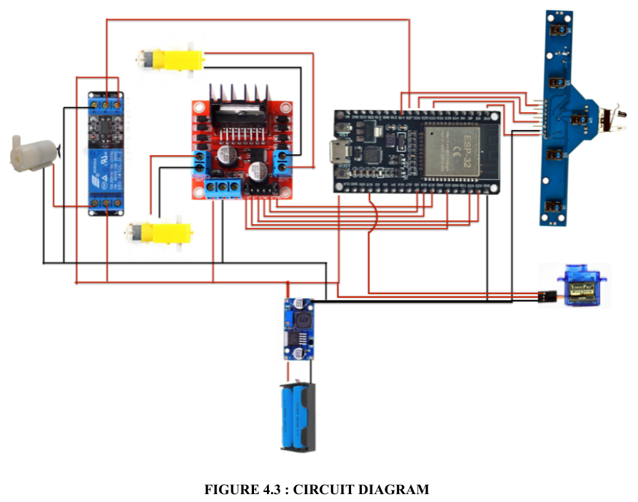

# autonomous-fire-fighting-robot
ESP32-based autonomous fire-fighting robot prototype using flame detection, ESP-NOW communication, sensor integration and motor control.

## Working Principle

1. The remote fire detection unit monitors for fire using a flame sensor.
2. ESP32 #1 sends fire detection information and flame direction to the robot through ESP-NOW.
3. ESP32 #2 receives the wireless message.
4. The robot follows a predefined path using its IR sensor array.
5. When a fire alert is received, the robot stops.
6. The servo motor adjusts the water nozzle according to the received flame direction.
7. The water pump activates for a predefined duration of 5 seconds.
8. The pump switches off automatically after the 5-second interval.
9. The robot resumes line-following operation.

## System Architecture

### Node 1: Remote Fire Detection Unit
- ESP32 #1
- Flame Sensor 1
- ESP-NOW wireless communication

### Node 2: Mobile Fire-Fighting Robot
- ESP32 #2 (main controller)
- Onboard Flame Sensor 2
- 5-channel IR sensor for line following
- Motor driver and DC motors
- Water pump for fire suppression

### Communication
ESP-NOW enables wireless communication between the remote fire detection unit and the mobile robot without requiring a Wi-Fi router.

## Hardware Components

| Component | Quantity | Purpose |
|---|---:|---|
| ESP32 Development Board | 2 | Wireless communication and robot control |
| Flame Sensor | 2 | Remote and onboard fire detection |
| 5-Channel IR Sensor | 1 | Line-following navigation |
| L298N Motor Driver | 1 | DC motor control |
| DC Geared Motors | 2 | Robot movement |
| SG90 Servo Motor | 1 | Nozzle direction control |
| Relay Module | 1 | Water pump switching |
| Water Pump | 1 | Fire suppression |
| Buck Converter | 1 | Voltage regulation |
| Battery | 1 | Power supply |

## Software and Communication
- Arduino IDE
- Embedded C / Arduino framework
- ESP-NOW wireless communication

## Project Prototype

*Physical prototype of the ESP32-based autonomous fire-fighting robot.*
## Circuit Diagram

## Pin Connections

| ESP32 GPIO | Component | Function |
|---|---|---|
| GPIO 21 | L298N ENA | Motor A speed |
| GPIO 22 | L298N IN1 | Motor A direction |
| GPIO 23 | L298N IN2 | Motor A direction |
| GPIO 19 | L298N ENB | Motor B speed |
| GPIO 18 | L298N IN3 | Motor B direction |
| GPIO 5 | L298N IN4 | Motor B direction |
| GPIO 26 | IR Sensor S1 | Left line detection |
| GPIO 33 | IR Sensor S3 | Centre line detection |
| GPIO 14 | IR Sensor S5 | Right line detection |
| GPIO 13 | SG90 Servo | Nozzle position control |
| GPIO 12 | Relay Module | Water pump control |

### Power Connections
- ESP32 VIN: Regulated 5V supply
- Servo VCC: Regulated 5V supply
- Common GND: Shared ground connection
